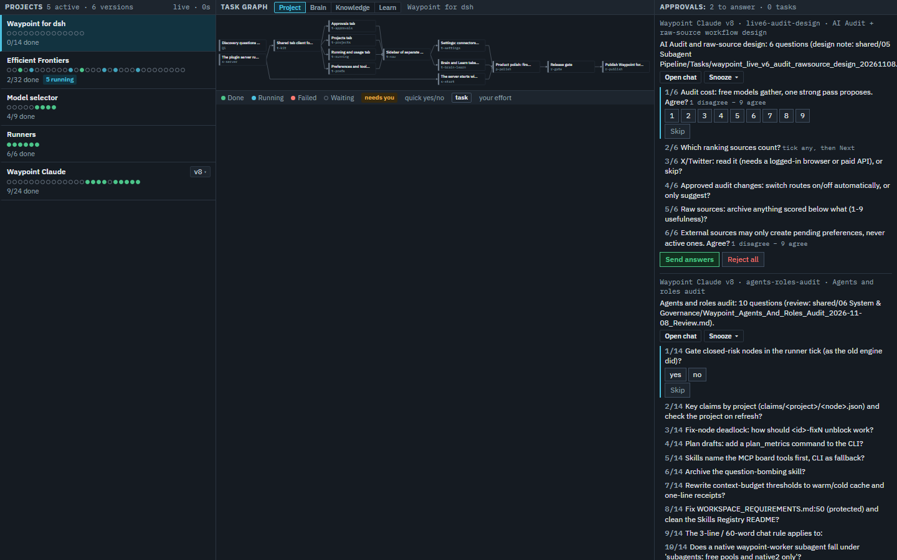
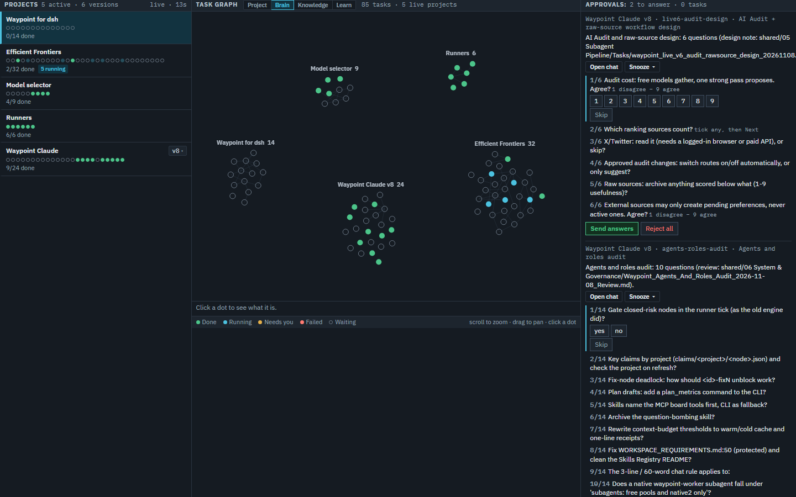

# Waypoint Claude dashboard

A single-page dashboard for your Waypoint work, shown as a Claude artifact. It reads your Waypoint data folder
through one local MCP server and shows the board, the questions your agents asked, running work and usage, your notes
as a graph, and a Learn view that teaches one step at a time. Everything stays on your machine: the page talks only
to the local `waypoint_claude` MCP server, with no telemetry and no paid API route.

The page is `artifacts/waypoint-claude.html`. The MCP server is `runner/waypoint_runner/mcp_claude.py`.

## Screenshots

The dashboard on a real data folder (the projects that build Waypoint itself).

**Board**: projects, the task graph of the selected one, and the questions waiting for you.



**Graph**: every live project's tasks as one map, coloured by status.



## Install for Claude Code

You need Claude Code (or the Claude desktop app) and Python 3.10 or newer. The server uses only the standard library.

1. Clone this repository.

   ```powershell
   git clone https://github.com/Robert-Study/waypoint-agents-claude.git
   cd waypoint-agents-claude
   ```

2. Pick a data folder. To try the page on sample data, use `core/waypoint-data/fixtures/sample-folder`. For your own
   work, use an empty folder that you keep (for example `~/.waypoint/data`).

3. Register the MCP server under the name `waypoint_claude`. The page looks for that exact name.

   ```powershell
   claude mcp add --scope user --env WAYPOINT_DATA_DIR=<data folder> --env WAYPOINT_MCP_BY=agent waypoint_claude -- <python> <clone>\runner\waypoint_runner\mcp_claude.py
   ```

   Replace `<python>` with your Python, `<clone>` with the full path of this folder and `<data folder>` with the folder
   from step 2. Check it with `claude mcp get waypoint_claude`; the status should be Connected.

4. Open the page as a Claude artifact. In a Claude Code session in this folder, ask Claude to publish
   `artifacts/waypoint-claude.html` as an artifact. Open it, then in the page's Permissions menu allow
   `host:waypoint_claude`. If the page says the board is unavailable, restart the Claude app after step 3 and allow
   the permission again.

The page works with the board tools alone. The Preferences review needs an optional add-on and stays hidden without
it; see [addons/README.md](addons/README.md).

## Engine and command line

The dashboard sits on the Waypoint engine. It is shared, byte for byte, with the sister repository `waypoint-agents`
(Waypoint on DeepSeek Harness). The file `ENGINE_VERSION` names its version and `ENGINE_MANIFEST.sha256` lists a
hash for every engine file.

| Part | Where | What it does |
|---|---|---|
| Data library | `core/waypoint-data` | Schemas, a sample data folder and the only code that writes the folder (TypeScript and Python twins). |
| Runner | `runner/waypoint_runner` | Starts when there is work and exits when idle; dispatches tasks, ingests receipts, serves the MCP tools. |
| Command line | `scripts/waypoint_cli.py`, `bin/waypoint.cmd` | Read the board, set task status, add and tick to-dos, start versions, check the install. |
| Engine | `engine/cc_engine` | The original HTTP engine and its test suite (plans, checks, scheduler). Standard library only. |
| Docs | `docs/` | File contract, API, CLI, architecture, token economy. |

Install the command line on Windows 10 or 11 with Python 3.10 or newer:

```powershell
powershell -ExecutionPolicy Bypass -File install.ps1
```

Open a new terminal, then:

```powershell
waypoint doctor
waypoint board
waypoint todo add "Read the API docs" --human
```

See [INSTALL.md](INSTALL.md) for switches and troubleshooting, [docs/CLI.md](docs/CLI.md) for every command and
[docs/ARCHITECTURE.md](docs/ARCHITECTURE.md) for how the parts fit.

Run the tests:

```powershell
python -m pytest engine/tests -q
python -m pytest scripts/tests -q
python scripts/export_core.py --scan .
```

## Licence

MIT. See [LICENSE](LICENSE).
